# SOI 1×4 cascaded-MZI wavelength demultiplexer at 1550 nm

We present a four-channel silicon photonic wavelength demultiplexer based on cascaded Mach–Zehnder interferometers with broadband directional couplers, operating on a 2 nm channel grid from 1553 to 1559 nm. Fabricated using 500 × 220 nm strip waveguides, the device exhibits 3-dB bandwidths of 1.6–1.8 nm, extinction ratios of 23–35 dB, and normalized insertion losses of 1.5–3.3 dB at 1550 nm.


*1×4 demux based on cascaded MZIs*

Every figure and number below is regenerated from the raw data in this repository by the scripts in `analysis/`.

## I. Introduction

Wavelength division multiplexing (WDM) carries several optical channels on a single fiber and separates them again at the receiver (Fig. 1). On-chip wavelength demultiplexers are therefore key building blocks of silicon photonic transceivers, and silicon-on-insulator (SOI), with its high index contrast and CMOS compatibility, is a natural platform for them [2].

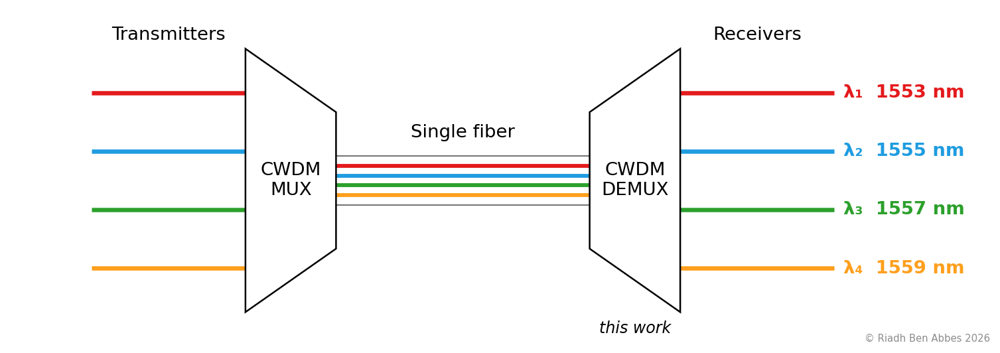

*Fig. 1. Coarse WDM link. This work implements the on-chip 1×4 demultiplexer for four channels on a 2 nm grid.*

Cascaded Mach–Zehnder interferometers (MZIs) are well established for on-chip wavelength routing [3] and provide a passive alternative to microring filters [4], which generally require active resonance tuning. Their performance depends on the splitting ratio of the couplers at each stage: conventional directional couplers are strongly wavelength dependent, whereas broadband directional couplers (BDCs) keep a near 50/50 split over a wide band through an asymmetric phase-control section [1]. Here, four channels at 1553, 1555, 1557 and 1559 nm are targeted, using the SiEPIC PDK in KLayout and Lumerical INTERCONNECT for circuit simulation [7], within the UBCx Phot1x course [5].

## II. Theoretical background

### A. Choice of the path-length differences

Strip waveguides of 500 × 220 nm support a single quasi-TE mode at 1550 nm. The free spectral range of an MZI with path-length difference $\Delta L$ is

$$\mathrm{FSR} = \frac{\lambda_0^2}{n_g\,\Delta L}, \qquad n_g \approx 4.2$$

A binary tree that separates $N = 2^k$ channels spaced by $\Delta\lambda_{ch}$ needs $k$ stages. Stage $i$ must send channels that are $2^{i-1}\Delta\lambda_{ch}$ apart to opposite ports, i.e. half a period apart, which sets

$$\mathrm{FSR}_i = 2^i\,\Delta\lambda_{ch} \quad\Rightarrow\quad \Delta L_i = \frac{\lambda_0^2}{n_g\,2^i\,\Delta\lambda_{ch}}$$

For $N = 4$ channels ($k = 2$) on a $\Delta\lambda_{ch} = 2$ nm grid at $\lambda_0 = 1550$ nm [2]:

| Stage | Channels separated | FSR | ΔL |
|---|---|---|---|
| 1 | 2 nm apart (λ₁, λ₃ / λ₂, λ₄) | 4 nm | 143 µm |
| 2 | 4 nm apart (λ₁ / λ₃ and λ₂ / λ₄) | 8 nm | 71.5 µm |

### B. Choice of the directional coupler

The extinction of each MZI depends on its two couplers splitting the light 50/50 at every channel wavelength. A conventional directional coupler is strongly wavelength dependent, so its splitting ratio drifts away from 50/50 across the band. A broadband directional coupler (BDC) was therefore chosen: in its asymmetric section, two waveguides of different widths introduce a controlled phase mismatch that compensates for the wavelength dependence of the coupling coefficient, giving a quasi-constant 50/50 splitting ratio over more than 100 nm [1].

## III. Broadband directional coupler

The coupler is the `ebeam_bdc_te1550` cell of the SiEPIC PDK [1]. Read from the GDS (Fig. 2a, b), it consists of two 500 nm waveguides separated by a 200 nm gap over a 50.7 µm coupling region, which contains a 2.5 µm asymmetric phase-control section where the widths become 600 and 400 nm. A stand-alone BDC test structure was measured against an on-chip reference waveguide (Fig. 2c).

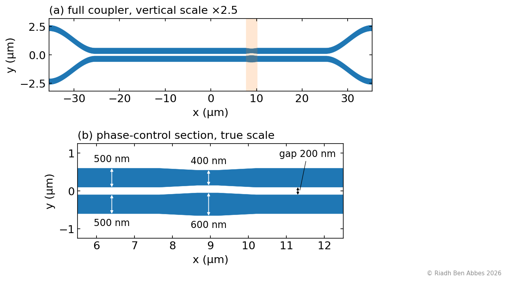 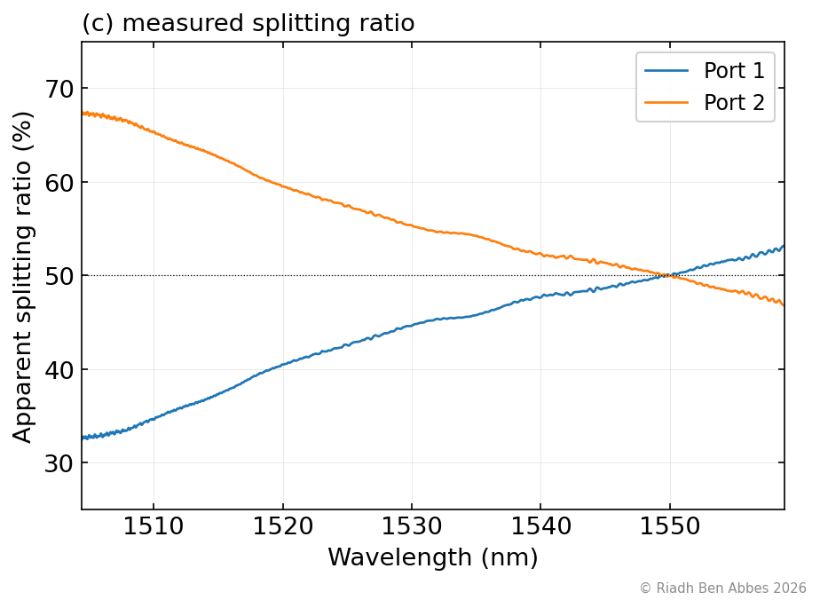

*Fig. 2. Broadband directional coupler. Geometry of the `ebeam_bdc_te1550` cell extracted from the layout: (a) full coupler, the shaded band marks the phase-control section; (b) phase-control section at true scale. (c) Measured apparent splitting ratio P₁/(P₁+P₂), which includes the response of the two output grating couplers.*

The split is **50.0 / 50.0 % at 1550 nm**, with no measurable excess loss (P₁ + P₂ within −0.01 to +0.25 dB of the reference). The apparent ratio drifts across the band, but the two output grating couplers have envelopes offset by 2.3 nm, which alone produces a drift of the same order: this structure cannot isolate the intrinsic wavelength dependence of the BDC.

## IV. Demultiplexer architecture

The demultiplexer is a two-stage MZI binary tree (Fig. 3). Stage 1 (MZI 1, ΔL₁ = 143 µm) separates {λ₁, λ₃} from {λ₂, λ₄}; each stage-2 MZI (MZI 2A and 2B, ΔL₂ = 71.5 µm) then separates the remaining pair.

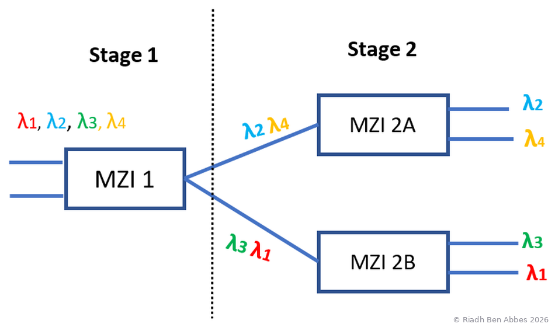 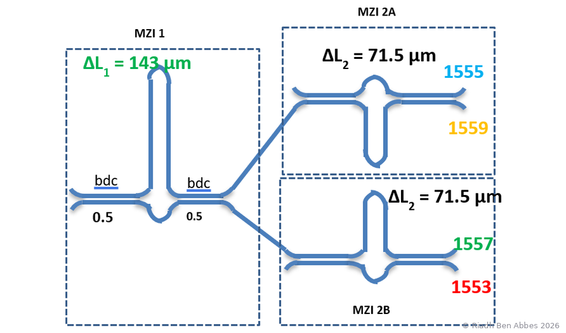

*Fig. 3. Demultiplexer architecture: wavelength routing through the two-stage MZI tree (left) and circuit schematic with path-length differences and BDCs (right).*

| Parameter | Stage 1 | Stage 2 |
|---|---|---|
| Path-length difference ΔL | 143 µm | 71.5 µm |
| Target FSR | ≈ 4 nm | ≈ 8 nm |
| Coupler | `ebeam_bdc_te1550` | `ebeam_bdc_te1550` |
| Waveguide | 500 × 220 nm strip | 500 × 220 nm strip |

Stand-alone MZIs of each stage were measured to check the delay lines (Fig. 4).

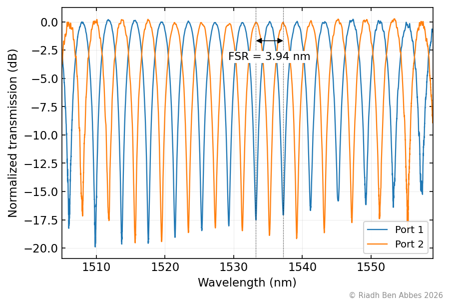 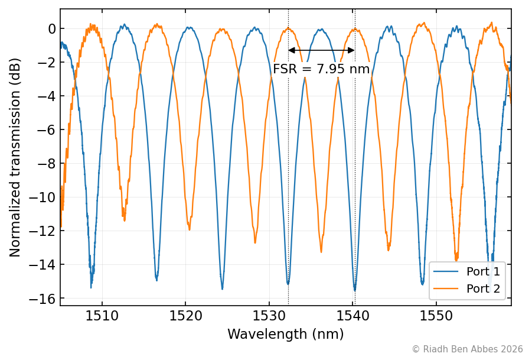

*Fig. 4. Stand-alone MZI test structures: stage 1 (left) and stage 2 (right).*

| Test structure | Measured FSR (port 1 / port 2) | Design |
|---|---|---|
| MZI stage 1 (ΔL = 143 µm) | 3.94 / 3.95 nm | ≈ 4 nm |
| MZI stage 2 (ΔL = 71.5 µm) | 7.97 / 7.94 nm | ≈ 8 nm |

## V. GDS layout

The layout was generated with the SiEPIC PDK in KLayout. Two layouts were fabricated, both available in [`layout/`](layout/). The 605 × 410 µm cell contains the 1×4 demultiplexer together with stand-alone stage-1 and stage-2 MZIs and a BDC test structure, all accessed through focusing grating couplers on a 127 µm pitch (Fig. 5).

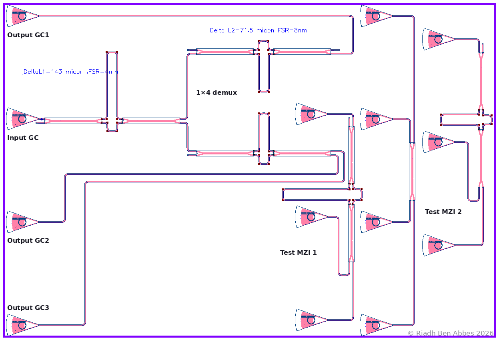

*Fig. 5. KLayout view of the GDS cell: 1×4 demultiplexer (left), stand-alone stage-1 MZI, BDC and stage-2 MZI test structures (right).*

The path-length differences extracted from the waveguide lengths stored in the GDS match the design:

| Structure | ΔL |
|---|---|
| Demultiplexer, MZI 1 | 143.0 µm |
| Demultiplexer, MZI 2A | 71.5 µm |
| Demultiplexer, MZI 2B | 71.5 µm |
| Test MZI, stage 1 | 143.0 µm |
| Test MZI, stage 2 | 71.5 µm |

MZI 2A and 2B have strictly identical delay lines, with no phase offset between them, which is consistent with the non-uniform channel spacing discussed in Section VII. One output of MZI 2A ends in an `ebeam_terminator_te1550` on purpose: the fiber array of the test setup gives access to one input and three outputs per device, so this cell routes three outputs.

The second layout, [`EBeam_RiadhCWDM_otp1.gds`](layout/EBeam_RiadhCWDM_otp1.gds), contains an identical copy of the demultiplexer in which only that remaining output is routed to a grating coupler (Fig. 6).

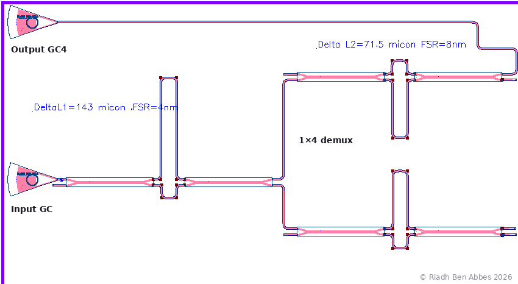

*Fig. 6. KLayout view of the duplicate demultiplexer in the second layout: only the output of MZI 2A that is terminated in the first layout is routed, to Output GC4.*

## VI. Device fabrication

The chip was fabricated through the Applied Nanotools NanoSOI MPW process [6]: 100 keV electron-beam lithography on 220 nm SOI with a 2 µm buried oxide, chlorine ICP-RIE etch and a 2.2 µm PECVD oxide cladding. The full process is given in [Appendix B](#appendix-b-fabrication-process).

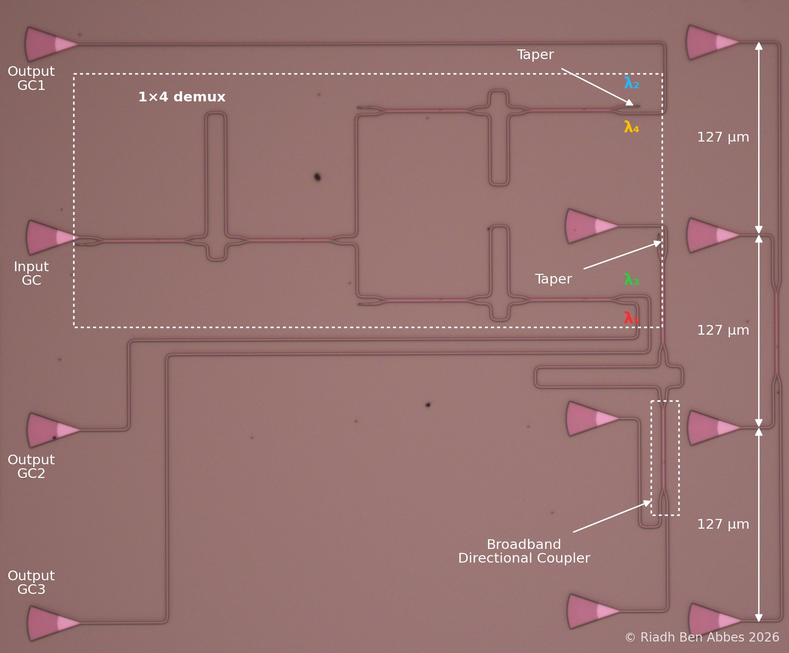

*Fig. 7. Optical micrograph of the fabricated chip.*

On this device, three of the four outputs are routed to grating couplers and one port of MZI 2A ends in a terminator, as designed (Section V); the fourth output is accessed on the duplicate demultiplexer of the second layout.

## VII. Lumerical INTERCONNECT simulation

The circuit was simulated in Lumerical INTERCONNECT [7] with the `ebeam_bdc_te1550` compact model, from 1499 to 1601 nm (5000 points, about 20 pm step).

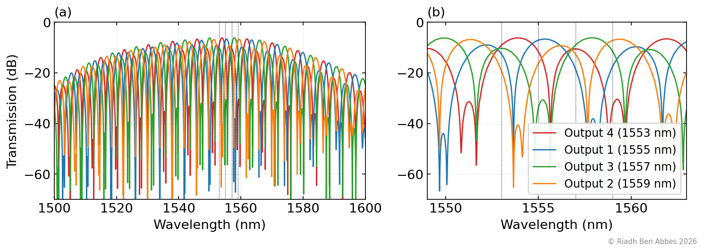

*Fig. 8. Simulated transmission of the four outputs, including the grating-coupler response: (a) full span, (b) channel window. Dotted lines mark the design channels.*

| Channel | Target | Simulated peak | 3-dB BW | Normalized IL | ER | Isolation |
|---|---|---|---|---|---|---|
| Ch. 1 (Output 4) | 1553 nm | 1553.84 nm | 1.79 nm | 0.76 dB | 50.2 dB | 7.8 dB |
| Ch. 2 (Output 1) | 1555 nm | 1555.32 nm | 1.75 nm | 1.22 dB | 60.4 dB | 6.3 dB |
| Ch. 3 (Output 3) | 1557 nm | 1557.96 nm | 1.79 nm | 0.70 dB | 50.1 dB | 9.4 dB |
| Ch. 4 (Output 2) | 1559 nm | 1559.36 nm | 1.77 nm | 1.12 dB | 54.6 dB | 6.7 dB |

ER is the peak-to-null extinction of each output within ±4 nm of its peak; isolation is the margin between an output and the strongest other output at its peak, which measures the channel separation.

The simulated channel spacing is **1.48 / 2.64 / 1.40 nm** instead of a uniform 2 nm, and each output shows a secondary passband about 4 dB below the main one. The path-length differences set the correct FSR, but the absolute phase of each MZI is not trimmed onto the channel grid (in particular the quarter-period offset needed between MZI 2A and 2B). An idealized analytical model of the same tree reproduces this behaviour and recovers a uniform 2 nm grid with more than 20 dB isolation once the phases are aligned.

## VIII. Experimental characterization

Spectra were recorded with a swept tunable laser from 1475 to 1583 nm (8 pm step) and stored as MATLAB files [8]; the setup is described in [Appendix A](#appendix-a-measurement-setup). Each output is normalized to an on-chip reference waveguide, and the analysis is restricted to **1504–1559 nm**, where the reference is at least 10 dB above the noise floor.

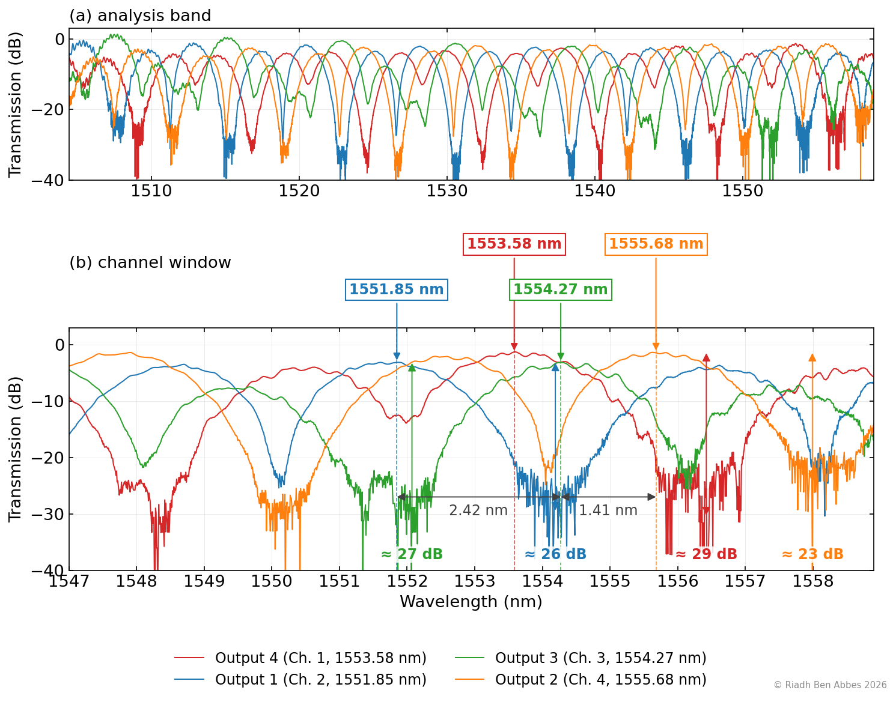

*Fig. 9. Measured normalized transmission of the demultiplexer outputs: (a) analysis band; (b) channel window, with the peak wavelength and extinction of each output and the spacing between the outputs recorded in the same scan. Output numbers and colors follow Fig. 8; Outputs 1 to 3 come from the three-output device, Output 4 from the duplicate device.*

| Channel | Target | Measured peak | 3-dB BW | Normalized IL | ER | Isolation |
|---|---|---|---|---|---|---|
| Ch. 1 (Output 4, duplicate device) | 1553 nm | 1553.58 nm | 1.77 nm | 1.49 dB | 28.8 dB | n/a |
| Ch. 2 (Output 1, MZI 2B) | 1555 nm | 1551.85 nm | 1.66 nm | 3.21 dB | 26.2 dB | 1.2 dB |
| Ch. 3 (Output 3, MZI 2A) | 1557 nm | 1554.27 nm | 1.72 nm | 3.26 dB | 27.0 dB | 13.0 dB |
| Ch. 4 (Output 2, MZI 2B) | 1559 nm | 1555.68 nm | 1.70 nm | 1.48 dB | 22.8 dB | 6.0 dB |

Outputs 1, 3 and 2 are spaced by 2.42 and 1.41 nm instead of 2 nm, as in simulation, with an FSR of 7.74–7.90 nm. Channel targets assume a −3.5 nm offset, attributed to manufacturing variability: deviations of the waveguide width and thickness shift the effective index, and hence the channels, and slightly alter the BDC splitting ratio, which limits the extinction. Output 4, measured on the duplicate device, is assigned to the remaining channel by elimination.

## IX. Conclusion

A four-channel SOI demultiplexer based on a two-stage cascaded MZI tree with broadband directional couplers was designed, simulated, fabricated and characterized. The stand-alone MZIs reproduce the target FSRs (3.94 and 7.95 nm), and the BDC splits 50/50 at 1550 nm without measurable excess loss. The demultiplexer outputs show 1.6–1.8 nm passbands with 23–35 dB extinction. Simulation and measurement both reveal a non-uniform channel spacing, traced to the absolute phase of the MZIs not being aligned with the channel grid. Trimming these phases is the next design step.

## Repository structure

```
analysis/       scripts (one per figure) and the shared plotting style
simulation/     INTERCONNECT exports (raw/) and the merged CSV
measurement/    raw .mat files (raw/), normalized spectra and extracted metrics
layout/         GDS files of the two fabricated layouts
figures/        README figures (PNG); figures/paper/ holds the report versions (PDF, PNG 300 dpi)
```

## Reproduce

```bash
pip install -r requirements.txt
python analysis/cwdm_concept.py
python analysis/layout_figures.py
python analysis/bdc_analysis.py
python analysis/mzi_fit.py measurement/raw/mzi_stage1_dL143_2025-11-17_025351.mat --name fig06_mzi_stage1
python analysis/mzi_fit.py measurement/raw/mzi_stage2_dL71p5_2025-11-17_025229.mat --name fig07_mzi_stage2
python analysis/annotate_micrograph.py
python analysis/stamp_images.py
python analysis/sim_interconnect.py
python analysis/meas_demux.py
```

## Acknowledgment

We acknowledge the edX UBCx Phot1x Silicon Photonics Design, Fabrication and Data Analysis course, which is supported by the Natural Sciences and Engineering Research Council of Canada (NSERC) Silicon Electronic-Photonic Integrated Circuits (SiEPIC) Program. The devices were fabricated by Cameron Horvath at Applied Nanotools, Inc. Mateo Branion-Calles performed the measurements at The University of British Columbia. We acknowledge Lumerical Solutions, Inc., MathWorks, Mentor Graphics, Python, and KLayout for the design software.

## References

1. Z. Lu et al., "Broadband silicon photonic directional coupler using asymmetric-waveguide based phase control," *Opt. Express*, vol. 23, no. 3, pp. 3795–3808, 2015. [doi:10.1364/OE.23.003795](https://doi.org/10.1364/OE.23.003795)
2. L. Chrostowski and M. Hochberg, *Silicon Photonics Design*. Cambridge Univ. Press, 2015.
3. H. Xu and Y. Shi, "Flat-top CWDM (de)multiplexer based on MZI with bent directional couplers," *IEEE Photon. Technol. Lett.*, vol. 30, no. 2, pp. 169–172, 2018. [doi:10.1109/LPT.2017.2779489](https://doi.org/10.1109/LPT.2017.2779489)
4. W. Bogaerts et al., "Silicon microring resonators," *Laser Photonics Rev.*, vol. 6, no. 1, pp. 47–73, 2012.
5. UBCx, *PHOT1x – Silicon Photonics Design, Fabrication and Data Analysis*, edX / University of British Columbia, 2025.
6. Applied Nanotools Inc., *NanoSOI Multi-Project Wafer (MPW) Process Description*, Edmonton, Canada, 2023.
7. Lumerical Solutions Inc., *MODE Solutions, FDTD Solutions and INTERCONNECT Documentation*, Ansys Inc., 2023.
8. MathWorks, *MATLAB R2023b Documentation: Curve Fitting Toolbox and Signal Processing Toolbox*, Natick, MA, USA, 2023.

## Appendix A: Measurement setup

To characterize the devices, a custom-built automated test setup with automated control software written in Python was used. An Agilent 81600B tunable laser was used as the input source and Agilent 81635A optical power sensors as the output detectors. The wavelength was swept from 1475 to 1583 nm in 8 pm steps. A polarization-maintaining (PM) fiber was used to maintain the polarization state of the light and to couple the TE polarization into the grating couplers. A polarization-maintaining fiber array was used to couple light in and out of the chip.

Raw spectra are stored as MATLAB files in `measurement/raw/` (`testResult.header.wavelength` in nm, `testResult.rows.channel_1` to `channel_4` in dBm, one channel per detector).

## Appendix B: Fabrication process

The photonic devices were fabricated using the NanoSOI MPW fabrication process by Applied Nanotools Inc., which is based on direct-write 100 keV electron-beam lithography. Silicon-on-insulator wafers of 200 mm diameter, 220 nm device thickness and 2 µm buffer oxide thickness are used as the base material. The wafer was pre-diced into 25 × 25 mm square substrates, and lines were scribed into the substrate backsides to facilitate separation into smaller chips once fabrication was complete.

After an initial wafer clean in piranha solution (3:1 H₂SO₄:H₂O₂) for 15 minutes and a water/IPA rinse, hydrogen silsesquioxane (HSQ) resist was spin-coated onto the substrate and heated to evaporate the solvent. The devices were patterned using a JEOL JBX-8100FS electron-beam instrument at The University of British Columbia. The exposure dose was corrected for proximity effects resulting from the backscatter of electrons from nearby features, and the shape writing order was optimized for efficient patterning and minimal beam drift.

After exposure and development in a tetramethylammonium hydroxide (TMAH) solution, the devices were inspected optically for residues and defects. The chips were then mounted on a 4" handle wafer and etched by an anisotropic chlorine-based ICP-RIE process, after qualification of the etch rate. The resist was removed using a 10:1 buffered oxide etch, and the devices were inspected by scanning electron microscopy (SEM) to verify patterning and etch quality. A 2.2 µm oxide cladding was deposited by plasma-enhanced chemical vapor deposition (PECVD) based on tetraethyl orthosilicate (TEOS) at 300 °C. Reflectometry measurements were performed throughout the process to verify the device layer, buffer oxide and cladding thicknesses before delivery.

## License

© 2026 Riadh Ben Abbes. All rights reserved. This work is shared for consultation only: no part of it (code, data, layouts, figures, text) may be reproduced, modified or redistributed without the author's prior written permission. See [LICENSE](LICENSE).

## Author

Riadh Ben Abbes, Institut des NanoSciences de Paris (INSP), Sorbonne Université / CNRS.
